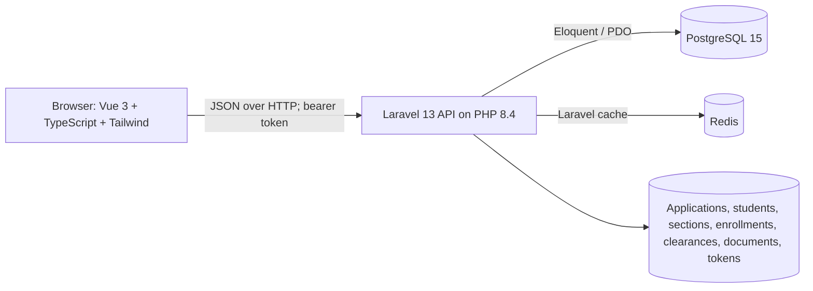

# PINACALL System Guide

This guide explains the first-party PINACALL application source, how its pieces fit together, what the local stack runs, and what remains prototype-only. It intentionally excludes generated dependencies and build/runtime output such as `api/vendor/`, `frontend/node_modules/`, `frontend/dist/`, Laravel caches/logs, and local environment files.

## 1. Purpose and Scope

PINACALL is a role-based academic services prototype intended to reduce separate in-person visits for enrollment, academic clearance, grade viewing, and student document requests. It has a Vue single-page application (SPA), a Laravel JSON API, PostgreSQL storage, and Redis cache service.

It provides student, registrar, cashier, department-head, faculty, and administrator views. The API performs role and record ownership checks; frontend navigation alone is not a security control.

This is not yet a production university system: payment is simulated, requested documents are not generated or delivered by an integrated records system, demo grades/data are not official, and no institution-specific policy has been approved by this software. Production deployment, compliance, privacy, accessibility, audit, backup, and operational requirements must be completed by the institution.

## 2. Architecture at a Glance



The browser is served from port `5173` and calls the API at port `8000` in the local Compose setup. The API connects to PostgreSQL at the internal Compose hostname `db:5432` and Redis at `redis:6379`. The browser's API address is configured with `VITE_API_BASE_URL`.

## 3. Repository Map

### Root files

- `.dockerignore`: excludes dependencies, local SQLite files, Laravel logs, and Git metadata from Docker build contexts.
- `.gitignore`: ignores root environment files so deployment secrets are not committed.
- `docker-compose.yml`: defines PostgreSQL, Redis, API, and frontend services, local ports, the persistent PostgreSQL volume, health checks, and deployment-variable substitutions.
- `Dockerfile.api`: builds the PHP/Laravel API image, installs required PHP extensions and Redis support, installs Composer packages, then migrates the database and conditionally seeds demo fixtures on startup.
- `Dockerfile.frontend`: installs the frontend npm dependencies and starts Vite's development server. It is not a production static web-server image.
- `Makefile`: convenience targets for Compose startup, stop, logs, build, migration, demo seed, isolated tests, and local host development.

### API: `api/`

This is a Laravel 13 JSON API project. `composer.json` and `composer.lock` define PHP packages and reproducible versions; `artisan` is Laravel's command-line entry point; `public/index.php` receives HTTP requests; `bootstrap/app.php` wires API/web/console routing, health endpoint `/up`, CORS middleware, JSON error rendering, and the `portal.token` middleware alias.

- `routes/api.php`: declares unauthenticated login/registration and the authenticated API route group.
- `routes/web.php`: Laravel web routes (the interactive portal is the separate Vue frontend).
- `routes/console.php`: application-specific Artisan command registration.
- `app/Http/Controllers/AuthController.php`: login, student registration, administrator-only account registry, current-user response, logout, and token issuance. Tokens are random values returned once, persisted as SHA-256 hashes, and expire after eight hours.
- `app/Http/Middleware/AuthenticatePortalToken.php`: verifies the bearer token hash, expiry, active account, and last-used timestamp; rejects missing/invalid sessions with HTTP 401.
- `app/Http/Controllers/EnrollmentApplicationController.php`: student application submission and self-access, registrar/admin queue and student registry, filtering, and application review/approval with optional section assignment.
- `app/Http/Controllers/ClearanceController.php`: student clearance initiation and viewing, workflow-step sign-off, role-to-office checks, remarks, and overall cleared/pending state.
- `app/Http/Controllers/GradesController.php`: course and grade queries, faculty/department access boundaries, grade validation/computation, roster checks, and explicit grade release.
- `app/Http/Controllers/SectionController.php`: sections and faculty lists, department/admin section maintenance, rosters, student enrollment, capacity/open-state checks, and enrollment transaction handling.
- `app/Http/Controllers/DocumentRequestController.php`: student document requests, prototype fee calculation, cashier payment-state changes, and registrar processing/release transitions.
- `app/Http/Controllers/DashboardController.php`: aggregate counts for authorized administrator/registrar dashboards.
- `app/Http/Controllers/PortalAdminController.php`: administrator-only user and course create/update operations with validation and log entries.
- `app/Http/Controllers/Controller.php`: common Laravel controller base.
- `app/Models/`: Eloquent database models and relationships, described in the data model section below.
- `app/Providers/AppServiceProvider.php`: application service-provider registration and shared boot configuration.
- `bootstrap/providers.php`: Laravel provider list.
- `config/`: Laravel settings for application, authentication, cache, CORS, database, filesystems, logging, mail, queue, services, and sessions. Values are read from environment variables; Compose overrides the settings needed by its containers.
- `database/migrations/`: ordered schema history. The initial migrations create users/cache/jobs, followed by student/course/enrollment/clearance/document tables; later migrations add student categories/applications and roles, academic sections and their roster pivot, API access tokens, department/section relationships, uniqueness constraints, and grade-release/account-activation fields. Migrations, not manually edited database files, are the schema source of truth.
- `database/seeders/DatabaseSeeder.php`: creates five staff/admin roles, six student lifecycle examples, ten sample course/section offerings, sample enrollment/grades, clearance records, and sample document requests. It is demonstration data, not production data.
- `database/factories/UserFactory.php`: test/factory support for user records.
- `tests/Feature/PortalWorkflowTest.php`: integration-style API feature coverage for seeded roles, the role-scoped application/clearance/enrollment/grade/document lifecycle, closed/full sections, existing enrollment reuse, grade release/visibility, and administrator-only maintenance.
- `tests/Feature/ExampleTest.php`, `tests/Unit/ExampleTest.php`, and `tests/TestCase.php`: Laravel example tests and shared test bootstrap.
- `phpunit.xml`: configures the automated test runtime; `Makefile`'s `test` target supplies in-memory SQLite and nonpersistent session/cache/queue settings to avoid the demo PostgreSQL database.
- `resources/`: Laravel's default CSS/view scaffolding. The user portal UI lives in `frontend/`.
- `.env.example`: local Laravel environment template. Do not copy local credentials or generated keys into documentation or source control.
- `api/AGENTS.md` and `api/CLAUDE.md`: scoped coding-agent instructions, not application runtime files.

### Frontend: `frontend/`

This is a Vue 3 + TypeScript SPA built with Vite and Tailwind CSS 4. `package.json` defines `dev`, type-checked production `build`, and `preview` scripts; `package-lock.json` locks npm dependency versions. `index.html` is the browser entry document. `vite.config.ts`, `tailwind.config.js`, `tsconfig*.json`, and `postcss.config.js` configure the frontend toolchain.

- `src/main.ts`: creates and mounts the Vue application.
- `src/App.vue`: top-level application shell, public landing/sign-in, role-based dashboard selection, and simple `/403`/unknown-path error handling.
- `src/style.css`: global Tailwind import and global styles.
- `src/assets/hero.png`: bundled visual asset used by the portal UI.
- `src/types/index.ts`: TypeScript contracts for users/roles, student types, applications, clearances, courses, sections, enrollments, documents, and dashboard statistics.
- `src/services/api.ts`: shared fetch client, bearer-token header handling, API error handling, Vue reactive auth/toast state, and functions for each API resource. The API base defaults to `http://localhost:8000/api` and can be set with `VITE_API_BASE_URL`.
- `src/services/navigation.ts`: active-page/navigation state helpers for the role dashboards.
- `src/components/Navbar.vue`, `Sidebar.vue`: shared header and role-aware navigation.
- `src/components/PortalErrorView.vue`, `Toast.vue`, `Modal.vue`: shared error, notification, and dialog presentation.
- `src/components/LoginModal.vue`: login/registration UI (also rendered inline for the public landing page).
- `src/components/EnrollmentForm.vue`, `ApplicationCard.vue`: application form and application summary/status presentation.
- `src/components/student/StudentDashboard.vue`: student application/progress, courses/grades, clearance, and document-request workspace.
- `src/components/registrar/RegistrarDashboard.vue`: application review, student registry, and document fulfillment workflows.
- `src/components/cashier/CashierDashboard.vue`: payment-status and cashier clearance actions. Payment recording is a simulation, not a payment processor.
- `src/components/dean/DeanDashboard.vue`: department/dean clearance and academic oversight entry point.
- `src/components/faculty/FacultyDashboard.vue`: assigned-section and gradebook workflow.
- `src/components/sections/SectionWorkspace.vue`: reusable section, assignment, roster, and enrollment workspace.
- `src/components/admin/AdminDashboard.vue`: admin metrics, account maintenance, and course catalog maintenance.

The UI uses one application shell rather than a full client-side routing framework. Dashboard navigation changes the current portal view; route paths are currently used only for the root and basic not-found/forbidden handling.

## 4. Roles and Main Workflows

| Role | Main actions and server-side boundary |
|---|---|
| Student | Register/sign in; submit and view own application; request own clearance, section enrollment, and documents; view own grades only when active, roster-enrolled, and released. |
| Registrar | Review applications, see the student registry, release grades, and advance paid document requests through fulfillment. |
| Cashier | Update document payment status and cashier clearance only. Payment is manually simulated. |
| Department head | Work with department courses/sections, assigned faculty/rosters, and department/dean clearance; grade access is department-scoped. |
| Faculty | Read assigned sections/rosters, enter grades for active roster records, and release grades only within assigned sections. |
| Administrator | Institution-wide metrics, account registry, user/course maintenance, and broader administrative workflow permissions. |

Enrollment lifecycle: student account/application -> registrar review -> optional matching/open section assignment -> clearance sign-offs -> section enrollment. Section enrollment validates student program/year, open status and capacity, and prevents duplicate section/course enrollment. The API uses a database transaction and locking around capacity-sensitive enrollment.

Grade lifecycle: assigned faculty enter midterm/final grades for active section-roster students -> the API validates a numeric 1–5 scale with up to two decimal places and computes the arithmetic mean when both periods exist -> a permitted staff role explicitly releases the grade -> only then can an active student with a matching current section-roster record read it. This is the implementation's prototype rule, not a claim that the scale or averaging policy is institution-approved.

Clearance lifecycle: cashier, library, department, dean, guidance, and registrar flags/remarks are tracked separately. Clearance becomes `cleared` only when every step is approved.

Document lifecycle: student request -> cashier marks paid -> registrar processes -> ready for pickup -> released. The API checks allowed transitions and payment state. Fees are fixed example amounts in code and are not a verified institutional fee schedule.

## 5. Data Model

- `User`: account identity, password hash, role, optional department, active flag. Has one optional student profile, many applications, assigned faculty sections, and API access tokens.
- `Student`: student number, program, year, student lifecycle category/status; belongs to a user and has applications, enrollments, one clearance, document requests, and many sections.
- `StudentApplication`: applicant/student links, program/year/term, background/contact/document metadata, status, reviewer notes, and assigned section label.
- `Course`: subject code/title/description/units/department/term/year and optional display metadata; has sections and enrollments.
- `AcademicSection`: one course offering with faculty, section code, program/year/term, schedule/room, capacity, and draft/open/closed status.
- `SectionEnrollment`: pivot/roster joining students and sections with enrollment status/time. A unique section/student pair prevents duplicate roster entries.
- `Enrollment`: student/course/optional section and term, midterm/final/computed grade, status, remarks, and explicit `grades_released` flag.
- `Clearance`: one student's office sign-off flags, remarks, term, and aggregate pending/cleared state.
- `DocumentRequest`: student, document kind/purpose/copies, example fee, payment state, fulfillment state, remarks, and release timestamp.
- `ApiAccessToken`: user, hashed bearer token, expiry, and last-used timestamp. The un-hashed token is returned at login and kept in browser session storage.

The migrations are the authoritative schema history. Models define relationships/casts; controllers enforce the business rules. There is no separate production-grade audit-log subsystem: administrator maintenance writes informational events to Laravel logs.

## 6. HTTP API Surface

Except for `POST /api/auth/login` and `POST /api/auth/register`, the routes below are in the `portal.token` protected group and expect `Authorization: Bearer <token>`. API responses are JSON.

| Method and path | Purpose |
|---|---|
| `POST /api/auth/login`, `POST /api/auth/register` | Sign in; create a student account/profile. Login/register have named throttle middleware. |
| `POST /api/auth/logout`, `GET /api/auth/me`, `GET /api/auth/personas` | Revoke current token, restore current account, admin-only account registry. |
| `GET /api/applications`, `POST /api/applications`, `GET /api/applications/{id}`, `PATCH /api/applications/{id}/review` | Submit/read/filter applications and registrar/admin review. |
| `GET /api/students` | Registrar/admin student registry. |
| `GET /api/clearances`, `POST /api/clearances/request`, `GET /api/clearances/{id}`, `PATCH /api/clearances/{id}/step` | Read/initiate clearance and approve a permitted office step. |
| `GET /api/courses`, `GET /api/grades`, `PATCH /api/grades/{id}`, `POST /api/grades/{enrollment}/release` | Course list, role-scoped grade list/edit/release. |
| `GET /api/documents`, `POST /api/documents/request`, `PATCH /api/documents/{id}/status` | Student requests and role-scoped payment/fulfillment updates. |
| `GET /api/dashboard/stats` | Admin/registrar aggregate statistics. |
| `GET /api/sections`, `GET /api/faculty`, `POST /api/sections`, `PATCH /api/sections/{section}`, `POST /api/sections/{section}/enroll`, `GET /api/sections/{section}/roster` | Section catalogs, authorized maintenance, enrollment and roster reads. |
| `POST /api/admin/users`, `PATCH /api/admin/users/{user}` | Admin-only user create/update. |
| `POST /api/admin/courses`, `PATCH /api/admin/courses/{course}` | Admin-only course catalog create/update. |

Laravel validation failures normally return HTTP 422; unauthorized access returns 401 or 403; missing records use Laravel's not-found behavior. Confirm every role/ownership rule and transition when changing endpoints.

## 7. Security and Data Handling

- Passwords are stored with Laravel hashing; bearer token plaintext is not stored in the database.
- Protected API routes require a non-expired token and active user; role and owner checks are implemented in endpoint controllers.
- Laravel validation is server-side and remains authoritative even when the browser also validates input.
- CORS uses the `FRONTEND_URL` environment setting; set it to the exact browser origin when hosting the frontend elsewhere.
- Use HTTPS, strong unique production secrets, restricted database credentials, backups, least privilege, monitoring, and a managed secret store before any public deployment.
- Demo seed data includes sensitive-looking fictional academic and contact fields. Treat it as disposable test data, not real student records.
- Do not run `migrate:fresh` or `docker compose down -v` against a database/volume whose data must be preserved.
- This prototype has not been independently security-audited. Rate limits exist on login/register routes, but production thresholds and abuse monitoring need review.

## 8. Local Development and Verification

Requires Docker Engine/Desktop and Compose v2. From the project root:

```sh
docker compose up --build -d
docker compose ps
docker compose logs -f api frontend
```

Local URLs: frontend `http://localhost:5173`; API `http://localhost:8000/api`; Laravel health check `http://localhost:8000/up`. On first startup the API applies migrations and only seeds when the users table is empty. The seed operation is not safe to repeat against a populated database.

```sh
# Build/type-check frontend
cd frontend && npm run build

# Isolated backend tests (requires running Compose API service)
make test
```

`make test` uses in-memory SQLite and array/sync session/cache/queue drivers. Never run mutating feature tests against a database containing data that must be retained. `docker compose down` stops containers but retains the named database volume; `docker compose down -v` deletes it.

## 9. Deployment Reality

The current Compose stack is a development/demo stack, not a production stack: `Dockerfile.frontend` runs Vite's development server and `Dockerfile.api` uses PHP's built-in web server. Before production, build and serve static frontend assets with a production web server and run Laravel on a production PHP application server behind HTTPS termination. Keep PostgreSQL/Redis private; do not publish their ports. Add a queue worker, monitoring, backup/restore procedures, log retention, deployment health checks, and migration/release policy.

Set Compose interpolation values in a secret-managed environment or an ignored root `.env`: `APP_ENV=production`, `APP_DEBUG=false`, public `APP_URL`, a generated stable `APP_KEY`, `DB_DATABASE`, `DB_USERNAME`, strong `DB_PASSWORD`, exact `FRONTEND_URL`, and browser-reachable `VITE_API_BASE_URL` ending in `/api`. `VITE_API_BASE_URL` is public build configuration, not a secret. Current published service ports are fixed in `docker-compose.yml`; edit/override them or remove public exposure in a production deployment.

## 10. First-Party Files Deliberately Excluded from This Guide

Generated dependencies (`api/vendor`, `frontend/node_modules`), generated frontend output (`frontend/dist`), Laravel runtime logs/cache, local environment files, and local database files are not application source and are intentionally not exhaustively documented. Dependency manifests/lockfiles and framework configuration remain part of the reproducible build/runtime, but their generated package contents are not part of the system source walkthrough.
