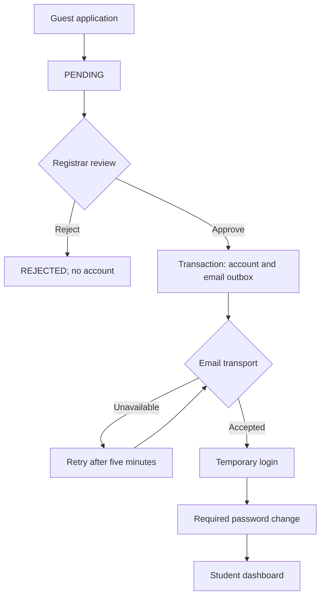

# PINACALL enrollment approval implementation

Base: reiy-git/PinaCall main, commit `553866aa1bf6307d6a0bfb8dc4c00fa064780bf8` (uploaded ZIP and live main matched when inspected).
Stack: Laravel 13 API, Vue 3 + TypeScript + Vite, custom hashed bearer tokens, PostgreSQL in Docker.

## Flow and data ownership

Guest -> POST /api/enrollees/apply -> PENDING application (no user, student or token).
Registrar/admin -> inspect private documents -> approve/reject.
Approval transaction -> student-role user + active student + approved legacy StudentApplication + pending Clearance + APPROVED guest application + durable provisioning email outbox.
Scheduled sender -> email temporary credentials -> student login -> /set-password -> all tokens revoked -> login with new password -> existing dashboard.
Rejected applications never provision an account. Approval is admission/account provisioning; existing payment, clearance and course enrollment requirements still apply.



## Database schema

- `enrollee_applications`: unique UUID reference; name, normalized email (unique), contact, program, category, year, background, private document metadata; uppercase PENDING/APPROVED/REJECTED; nullable unique user_id; reviewer ID, time, remarks. Pending applications have no auth relationship.
- `users`: must_change_password boolean (false for existing users), temporary_password_expires_at nullable timestamp. Password remains hashed by the existing User cast.
- `provisioning_emails`: unique user_id, encrypted temporary_password, attempts, available_at, sent_at. Written in the SAME approval transaction. An email outage cannot roll back a committed approval or lose its delivery intent.
- Existing `student_applications` uses lowercase statuses and remains the academic workflow model. Approval creates an approved record there for compatibility, without storing document paths or secrets.

The guest table intentionally allows one application per normalized email. Rejection is terminal; repeat applications and appeals need a school-defined policy before adding a resubmission feature. Email uniqueness resolves races; row locks serialize competing decisions on PostgreSQL/MySQL. Random institutional IDs use the existing unique student_number constraint; agree on the school's official numbering format before production.

## API contracts

| Method/path | Access | Contract |
|---|---|---|
| POST /api/enrollees/apply | Guest, IP throttled | multipart name, email, contact_number, program, student_type, year_level, educational_background, documents[]; returns 201 + reference/status, no auth token |
| GET /api/admin/enrollees | Registrar/admin | status=PENDING/APPROVED/REJECTED; page; paginated 20 rows; document names/indexes, no storage paths |
| GET /api/admin/enrollees/{id}/documents/{index} | Registrar/admin | authenticated attachment download, no public URL |
| POST /api/admin/enrollees/{id}/approve | Registrar/admin | optional remarks; 200; repeat approval returns existing result; rejected returns 409 |
| POST /api/admin/enrollees/{id}/reject | Registrar/admin | optional remarks; pending only; 200; terminal decision conflicts return 409 |
| POST /api/admin/enrollees/{id}/resend | Registrar/admin, throttled | reissue only while must_change_password=true; revokes old password/tokens, queues fresh credentials |
| POST /api/auth/first-login-reset | Bearer auth, throttled | current_password, password, password_confirmation; min 12 chars, different from temporary; revokes every token |
| POST /api/auth/register | Removed | 404, no account creation |

Guests cannot list applications, enumerate documents, or choose their role/status. Existing staff-only account management is retained as an administrative exception; it is not available to visitors. Existing user records are not retroactively disabled; audit and deactivate historic unenrolled accounts separately using the existing admin tooling.

## Frontend

`/enroll`: guest-only application form; receipt/reference after success; no password input.
`/admin/enrollees`: Registrar/admin review with statuses, pagination, remarks, attachment downloads, approval/rejection and credential reissue. Links are added to both existing staff dashboards.
`/set-password`: forced first-password form. Root App renders it whenever the restored/logged-in user has the flag, including if they try another page. Sidebar and dashboards are withheld. The API middleware blocks ALL portal routes while flagged except me/logout/first-login-reset; changing client state cannot bypass it.
The repository uses a single Vue root, not Vue Router. Paths are handled in App.vue with hosting fallback. `frontend/vercel.json` supports direct navigation when Vercel's root directory is frontend. Other hosting needs equivalent SPA rewrites.

## Local setup (PowerShell, from repository root)

Requires PHP >=8.4.1 (required by the current Composer lock), Composer, Node/npm; install the PHP PDO extension for your database and required XML/mbstring extensions. Use a development database, never a production database for tests.

```powershell
cd api
composer install
Copy-Item .env.example .env  # only if .env does not already exist
php artisan key:generate   # only for a NEW local environment
```

Edit api/.env: set the development DB connection, FRONTEND_URL, and PORTAL_URL. For SQLite, create database/database.sqlite and set DB_CONNECTION=sqlite, DB_DATABASE to its absolute path. For an existing configured environment keep its DB settings and APP_KEY.

```powershell
php artisan migrate
php artisan test
php artisan serve
```

Second terminal:

```powershell
cd frontend
npm ci
npm run build
npm run dev
```

Third terminal (in api):

```powershell
php artisan schedule:work
```

For a one-off local delivery check:

```powershell
php artisan enrollees:send-emails
```

## Mail configuration

Uses Laravel's existing SMTP transport; no Node mail server or new Composer production package is required. Use a local SMTP capture server such as Mailpit in development. Configure these existing env fields (secrets only in .env/deployment variables):

```dotenv
MAIL_MAILER=smtp
MAIL_SCHEME=smtp
MAIL_HOST=127.0.0.1
MAIL_PORT=1025
MAIL_USERNAME=null
MAIL_PASSWORD=null
MAIL_FROM_ADDRESS=registrar@example.edu
MAIL_FROM_NAME="PINACALL Registrar"
PORTAL_URL=http://localhost:5173
```

For production use the SMTP host/port, credentials and verified sender supplied by your provider (including Resend SMTP). Set MAIL_SCHEME=smtps for implicit TLS if your provider requires it, or smtp for STARTTLS as directed by the provider. Do not disable TLS. Run `php artisan config:clear` after changing local configuration; use `php artisan config:cache` during deployment.

The sender rejects log/array/failover mailers outside testing, so temporary credentials are never intentionally written to application logs or marked sent by a log fallback. SMTP acceptance is not proof of inbox delivery; monitor provider bounces. Failed delivery retries after five minutes. A crash after SMTP acceptance but before the DB commit may send a duplicate message: outbox delivery is at least once, not exactly once. The duplicate contains the same temporary password. `sent_at` means transport acceptance.

Temporary passwords expire 72 hours after approval/reissue. Registrar reissue generates a fresh password, revokes old tokens, and resets the outbox. The encrypted recoverable copy is cleared after successful mail delivery or password change. Expired copies are purged by the sender. Retain the APP_KEY safely and unchanged across API and scheduler; losing it makes pending encrypted credentials unreadable.

## Deployment requirements

The API Docker startup no longer regenerates APP_KEY. Supply a stable, unique APP_KEY in deployment variables; never use the Docker Compose demo key in production. Generate a new key only when creating a new environment, never on restart.

1. Back up the DB and deploy the additive migration with `php artisan migrate --force`.
2. Configure production SMTP, verified sender, HTTPS PORTAL_URL, FRONTEND_URL/CORS, and academic term settings.
3. Run one scheduler continuously (`php artisan schedule:work`) or cron `* * * * * cd /path/to/api && php artisan schedule:run >> /dev/null 2>&1`. A web process alone does not send emails. The outbox is custom; queue:work alone does not process it.
4. Keep a persistent PRIVATE volume for storage/app/private shared between API instances (or adapt the disk to private object storage). Uploaded documents must survive redeploys. Do not use storage:link for these files.
5. Set PHP upload_max_filesize >=5M and post_max_size above 25M, plus matching proxy request limits for five files.
6. Publish Vue build with SPA rewrites. Smoke-test direct /enroll, /admin/enrollees and /set-password routes.
7. Audit previously open-registered users; the migration deliberately preserves existing accounts and staff roles.

Rollback requires reverting the feature code BEFORE removing the new schema. Do not drop new tables once real applications have been collected without a data-retention/export decision. File malware scanning, retention rules and applicant appeal policies remain institution-specific follow-up work; MIME and size validation are implemented here.

## Review/test checklist

- Guest submission produces a PENDING guest application and private document; users/students/tokens counts stay unchanged.
- /auth/register is gone; ordinary student/faculty/cashier cannot list, review or download guest documents.
- Admin AND Registrar can inspect/approve; double approval creates one student, one auth user and one email intent.
- Rejection creates no user. Competing approval/rejection must settle on one terminal result.
- Email collision after submission returns 409 and preserves PENDING with no partially created student.
- SMTP unavailable: approval stays committed; outbox retries, no credentials returned by API.
- Login with temporary password renders forced reset; direct API /courses and other services return PASSWORD_CHANGE_REQUIRED.
- Bad current password, matching old/new password, short password or confirmation mismatch fails.
- Successful change clears flag, revokes old tokens and temporary login; new login unlocks dashboard.
- Expired credentials cannot log in or reset; Registrar reissue rotates password/tokens; activated accounts cannot reissue.
- Test actual PostgreSQL two concurrent approval requests before production: SQLite sequential tests cannot prove row-lock behavior.
- Smoke-test existing enrollment/clearance, staff dashboards and newly provisioned student's academic workflow.

## Official references

- https://laravel.com/docs/13.x/mail
- https://laravel.com/docs/13.x/scheduling
- https://docs.github.com/en/pull-requests/how-tos/create-pull-requests/creating-a-pull-request
